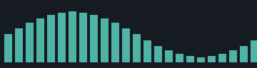

# Ingest lag, week 45

The 99th percentile was [412.3 ms](val:stats.p99_ms "gloss/duration;unit=ms"), against
[317.0 ms](val:stats.p99_prev_ms "gloss/duration;unit=ms") the week before, over
[1204113](val:stats.samples) samples.

## How the figures were collected

Three records. Each is computed on the server when the notebook is
collected, and stored; nothing below this section computes.

```sql
SELECT quantile(0.99)(lag_ms) AS p99_ms,
       quantileIf(0.99)(lag_ms, week = 44) AS p99_prev_ms,
       count() AS samples
FROM ingest_lag
```

^stats

```sql
SELECT toStartOfHour(ts) AS t, region, quantile(0.99)(lag_ms) AS p99
FROM ingest_lag GROUP BY t, region
```

^p99-by-hour

```sql
SELECT caller AS source, callee AS target, count() AS calls
FROM spans GROUP BY source, target
```

^calls

## By hour

The record as it is stored, eight rows of it:

```sql table
SELECT * FROM p99_by_hour LIMIT 8
```

The same record under the names a reader wants, with the lag shown as a
duration:

```sql table
SELECT t AS hour, region, p99 AS "p99@gloss/duration;unit=ms" FROM p99_by_hour LIMIT 8
```

As a chart. The cell gives the columns the names the chart reads: `x` is
the abscissa, `series` splits the rows into lines, and every number left
is a line's value:

```sql chart
SELECT t AS x, region AS series, p99 FROM p99_by_hour
```

The first half-day in a chart of its own, from the same stored record:

```sql chart
SELECT t AS x, region AS series, p99 AS "p99@gloss/duration;unit=ms" FROM p99_by_hour LIMIT 24
```

## What a cell may not do

A cell that filters is refused; a filtered view is a record of its own:

```sql table
SELECT * FROM p99_by_hour WHERE region = 'emea'
```

A cell that computes is refused; the computation belongs in a record:

```sql table
SELECT region, max(p99) FROM p99_by_hour GROUP BY region
```

## More than one relation

A panel that reads several relations takes them from the cell's WITH list.
The second member is a row of literals, the panel's settings:

```sql graphview
WITH edges AS (SELECT source, target FROM calls),
     graph_opts AS (SELECT 'hierarchical' AS layout)
SELECT * FROM edges
```

## Media

An image is prose; the markdown widget draws it. A recording is a cell:




A fence inside a list item is not a cell; it is shown as code:

- the statement an earlier draft used:

  ```sql table
  SELECT * FROM p99_by_hour
  ```
